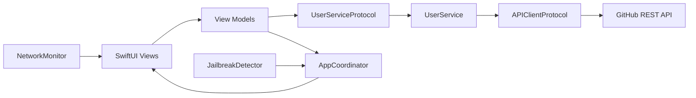

# GitProfile-Viewer

A production-minded iOS proof of concept for browsing public GitHub users and viewing profile details. The project demonstrates a clean SwiftUI architecture, protocol-driven dependencies, structured concurrency, explicit UI state management, coordinator-based navigation, and a focused automated test suite.

## Highlights

- Browse public GitHub users
- View profile information, biography, repository count, followers, and following
- Open validated GitHub profile links
- Pull to refresh the user list
- Loading, error, retry, and offline states
- Asynchronous avatar loading with placeholders
- Network reachability monitoring
- Device-integrity warning using jailbreak heuristics
- Dependency injection through protocols
- Coordinator-driven `NavigationStack` routing
- Comprehensive unit and view-construction tests

## Technology

- Swift 5
- SwiftUI
- Swift Concurrency (`async`/`await`)
- Combine observation with `ObservableObject` and `@Published`
- `URLSession` for networking
- `NWPathMonitor` for connectivity monitoring
- XCTest
- No third-party dependencies

## Architecture

The application follows MVVM with a coordinator responsible for navigation and dependency composition.



### Responsibilities

| Layer | Responsibility |
| --- | --- |
| Views | Render state and forward user actions |
| View models | Own presentation state and coordinate asynchronous work |
| Services | Express application-level GitHub operations |
| API client | Execute requests, validate responses, and decode models |
| Coordinator | Build screens and manage navigation routes |
| Core utilities | Connectivity, security checks, errors, and shared state types |

Key boundaries use protocols (`UserServiceProtocol`, `APIClientProtocol`, and `JailbreakDetecting`) so implementations can be replaced with deterministic test doubles.

## State Management

Screens model their lifecycle using a shared `ViewState` enum:

```swift
enum ViewState<T: Equatable>: Equatable {
    case idle
    case loading
    case loaded(T)
    case error(String)
}
```

This keeps loading, success, and failure handling explicit and prevents combinations of conflicting Boolean flags.

## Project Structure

```text
GitHubViewerPOC/
├── App/
│   └── GitHubViewerPOCApp.swift
├── Coordinator/
│   ├── AppCoordinator.swift
│   └── AppRoute.swift
├── Core/
│   ├── Network/
│   │   ├── APIClient.swift
│   │   └── NetworkMonitor.swift
│   ├── Security/
│   │   └── JailbreakDetector.swift
│   └── Utilities/
│       └── ViewState.swift
├── Features/
│   ├── Models/
│   │   └── GitHubUser.swift
│   ├── Services/
│   │   └── UserService.swift
│   ├── ViewModels/
│   │   ├── UserListViewModel.swift
│   │   └── UserDetailViewModel.swift
│   └── Views/
│       ├── Components/
│       ├── UserListView.swift
│       └── UserDetailView.swift
└── Tests/
    ├── Mocks/
    └── ViewModelTests/

GitHubViewerPOCTests/
└── GitHubViewerPOCTests.swift
```

## Requirements

- macOS with Xcode 26.2 or newer
- iOS 26.2 or newer, based on the current deployment target
- Internet access for live GitHub data

The app uses public GitHub endpoints and does not require an API key for basic use.

## Getting Started

1. Clone the repository:

   ```bash
   git clone <repository-url>
   cd GitHubViewerPOC
   ```

2. Open the project:

   ```bash
   open GitHubViewerPOC.xcodeproj
   ```

3. Select the `GitHubViewerPOC` scheme and an iOS Simulator.

4. Build and run with `⌘R`.

No package installation or environment configuration is required.

## API

The application currently uses two GitHub REST API endpoints:

```text
GET https://api.github.com/users?per_page=30
GET https://api.github.com/users/{username}
```

Requests include GitHub's versioned JSON media-type header. The API client maps transport, HTTP status, and decoding failures into domain-specific `NetworkError` values.

Because requests are unauthenticated, GitHub's unauthenticated rate limits apply.

## Testing

The suite covers view-model transitions, navigation behavior, service endpoint construction, model coding, network headers, successful responses, malformed payloads, HTTP failures, connectivity failures, reusable components, and primary SwiftUI states.

Run all tests from Xcode with `⌘U`, or from the command line:

```bash
xcodebuild \
  -project GitHubViewerPOC.xcodeproj \
  -scheme GitHubViewerPOC \
  -destination 'platform=iOS Simulator,name=iPhone 17 Pro' \
  -enableCodeCoverage YES \
  test
```

### Verified Coverage

The latest local run completed **25 tests with zero failures** and reported **93.37% application coverage**.

| Area | Coverage |
| --- | ---: |
| API client | 100% |
| User list view model | 100% |
| User detail view model | 100% |
| App coordinator | 96.30% |
| User detail view | 97.50% |
| User list view | 89.34% |

Some jailbreak-detection branches are intentionally unavailable in Simulator builds because they are compiled for physical-device execution only.

## Security Notes

- External profile links are displayed only when they use HTTPS and target `github.com`.
- Jailbreak detection is a defense-in-depth signal, not a guarantee of device integrity.
- No credentials or personal access tokens are stored by the app.
- Production deployments should add authenticated requests through secure credential storage if higher API limits are required.

## Current Scope and Trade-offs

This repository is intentionally focused on architecture and code quality rather than feature breadth.

- The list loads the first 30 public users.
- Pagination, search, caching, and authenticated GitHub sessions are not implemented.
- Avatar loading relies on `AsyncImage` and its system-managed cache behavior.
- The jailbreak detector uses common heuristics and may require policy-specific hardening for a production security model.

